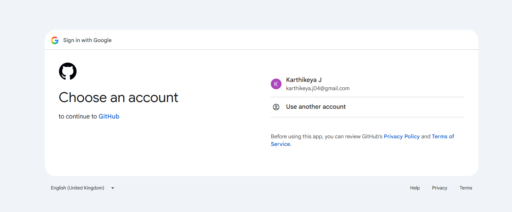
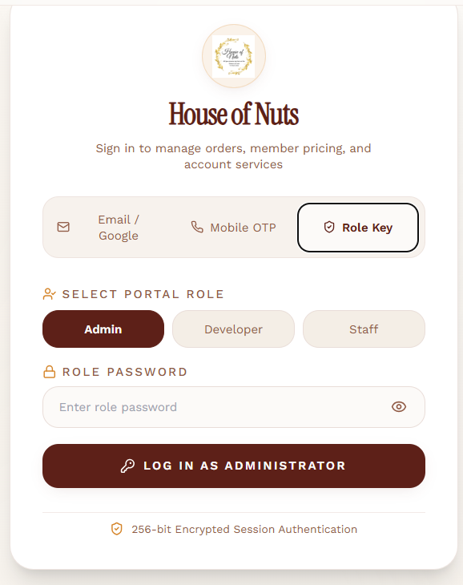
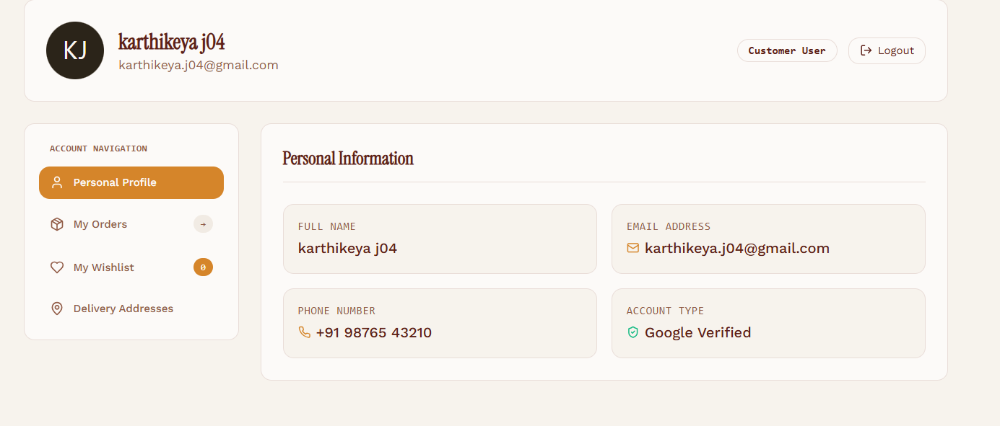

1. here see this imsg for sample when i m clickint the contiue with google its hoiwng all vaibel accotuns diaplay when user liciking only it iwll take to repeoctive action, butours not coming likethis

2.  don showt the roles topublic its data rstriction hereonly show the detials like login as staff thats enough for ui here

3. login with mobile otp make it lcok beacuase we didnt releasin in first go

4. Email Address
karthikeya.j04@gmail.com
Password (Optional)
make sure passrod need to match certain permisions okay and also  not there toe ditthe information also number id coming defualty fix this one take the needed information logginonly, and makethe edit option to the user adding anotherdelivery address, editing enabling and also delete enabling this all options should be enabled after login if normal user is logging  means 

5. afterloggout also still url is http://localhost:8080/account and still showing the detilas info there 