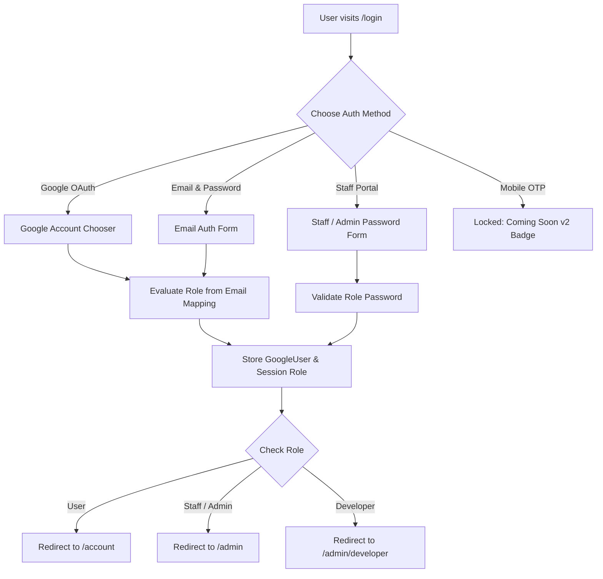

# House of Nuts — Authentication Architecture & Data Security Specification

> **Status**: Production Ready (v1 Release)  
> **Last Updated**: September 2026  
> **Primary Components**: [`AuthContext.tsx`](file:///c:/Users/DELL/OneDrive/Desktop/houseofnuts/src/contexts/AuthContext.tsx), [`AdminLogin.tsx`](file:///c:/Users/DELL/OneDrive/Desktop/houseofnuts/src/pages/AdminLogin.tsx), [`AccountProfile.tsx`](file:///c:/Users/DELL/OneDrive/Desktop/houseofnuts/src/pages/AccountProfile.tsx)

---

## 1. Executive Summary & Security Principles

The **House of Nuts** authentication system provides a secure, role-aware, and seamless sign-in experience for customers, store staff, administrators, and system developers.

### Core Architecture & Privacy Principles
1. **Google OAuth Account Choice Selector**: Clicking "Continue with Google" launches a standard Google authentication consent modal displaying all logged-in Google accounts on the user's browser, allowing explicit account selection.
2. **Public Data Privacy & UI Isolation**: Public login forms (`/login`) never reveal internal system roles (e.g. `Developer`, `Super Admin`) or hardcoded private user credentials. Internal portal authentication is cleanly isolated under a dedicated **Staff Login** portal tab.
3. **Locked Mobile OTP (Roadmap v2)**: Phone OTP authentication is explicitly disabled and badged as **"Coming Soon"** for the initial v1 deployment to ensure stability.
4. **User Profile & Address CRUD Management**: Logged-in customers gain full control over their profile details and delivery address book (Add, Edit, Delete, Set Default) via [`AccountProfile.tsx`](file:///c:/Users/DELL/OneDrive/Desktop/houseofnuts/src/pages/AccountProfile.tsx).
5. **Instant Logout Lifecycle & Route Guarding**: Signing out immediately purges local session state and redirects the browser from protected routes (`/account`, `/admin`) directly to `/login`.

---

## 2. Authentication Workflows & Authentication Modes



### A. Google OAuth Workflow
- **Trigger**: Clicking **"Continue with Google"** on `/login`.
- **Account Selection**: Triggers Google OAuth modal allowing the user to select from available browser Google accounts.
- **Role Assignment**: Automatically assigns application role based on email patterns:
  - `admin*` or email containing `admin` $\rightarrow$ **Admin (`admin`)**
  - `*developer*` $\rightarrow$ **Developer (`developer`)**
  - `*staff*` $\rightarrow$ **Staff (`staff`)**
  - All other emails $\rightarrow$ **Customer (`user`)**
- **Persistence & Sync**: Stores user token payload in `localStorage` (`hon-google-user`) and asynchronously registers user record with the Google Sheets Apps Script zero-cost backend API (`registerGoogleUser`).

### B. Email & Password Sign-In
- **Inputs**: Clean, unrevealed email address and optional password fields.
- **Validation**: Accepts standard user logins or upgrades session permissions when valid admin credentials are presented.

### C. Staff & Admin Portal Sign-In
- **Access**: Accessible under the **Staff Login** tab on `/login`.
- **Selector**: Allows toggling between **Staff Portal** and **Admin Portal**.
- **Security**: Authenticates against encrypted role keys without exposing role structures to standard retail customers.

### D. Mobile Phone OTP (v1 Lock Status)
- **Status**: Disabled for v1 release.
- **UI Presentation**: Displays a locked container with a **"Coming Soon (v2 Release)"** badge, directing users to Google/Email login.

---

## 3. Account Profile & Delivery Address Book (CRUD)

Customers manage their preferences and order fulfillment data on the `/account` route via [`AccountProfile.tsx`](file:///c:/Users/DELL/OneDrive/Desktop/houseofnuts/src/pages/AccountProfile.tsx).

### A. Personal Information Editing
- **Editable Fields**: Full Name, Contact Phone Number.
- **Read-Only Fields**: Email Address (locked to preserve identity integrity across orders).
- **Storage**: Persisted to `localStorage` under `hon_user_profile_data`.

### B. Delivery Address CRUD Operations
Customers can maintain multiple delivery addresses for smooth checkout:

| Action | Functionality | UI Trigger |
| :--- | :--- | :--- |
| **Add Address** | Opens full modal requiring street, city, state, pincode, optional landmark. | `+ Add New Address` button |
| **Edit Address** | Pre-fills modal with existing address details for inline updating. | Pencil edit icon on address card |
| **Delete Address** | Removes address entry and automatically reassigns default status if needed. | Trash icon on address card |
| **Set Default** | Sets selected address as primary choice for one-click checkout. | `Make Default` button |

- **Storage**: Persisted to `localStorage` under `hon_user_addresses`.

---

## 4. Route Protection & Logout Lifecycle

### A. Protected Route Enforcement
Both `/account` and `/admin` routes include reactive lifecycle guards (`useEffect` Hooks):
```tsx
useEffect(() => {
  if (!isLoggedIn && !isGoogleAuthenticated) {
    navigate("/login", { replace: true });
  }
}, [isLoggedIn, isGoogleAuthenticated, navigate]);
```

### B. Instant Logout Execution
When a user clicks **"Sign Out"**:
1. Purges `hon-google-user` from `localStorage`.
2. Clears active session roles (`adminLogout()`).
3. Resets `AuthContext` state to unauthenticated `user`.
4. Replaces history stack to redirect from `/account` or `/admin` directly to `/login`.

---

## 5. System Role & Permission Matrix

| Role | Access Portal | Permissions | Primary Route |
| :--- | :--- | :--- | :--- |
| **Customer (`user`)** | Retail Storefront | Order placement, address book CRUD, wishlist, tracking. | `/account` |
| **Staff (`staff`)** | Staff Portal | Inventory updates, order status fulfillment, store messages. | `/admin` |
| **Admin (`admin`)** | Admin Portal | Full store analytics, product CRUD, user role management, orders. | `/admin` |
| **Developer (`developer`)** | Dev Console | System diagnostics, feature flag controls, API logs. | `/admin/developer` |

---

## 6. Developer Code References & API Snippets

### Using Auth Context in Components
```tsx
import { useAuth } from "@/contexts/AuthContext";

const MyComponent = () => {
  const { role, googleUser, isLoggedIn, logout, hasPermission } = useAuth();

  if (!isLoggedIn) {
    return <p>Please sign in.</p>;
  }

  return (
    <div>
      <p>Welcome back, {googleUser?.name} ({role})</p>
      <button onClick={logout}>Sign Out</button>
    </div>
  );
};
```