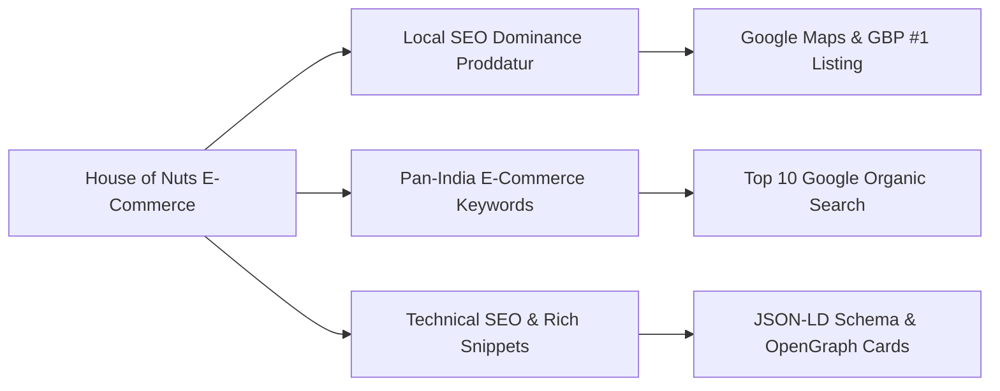

# House of Nuts — Search Engine Optimization (SEO) & Search Ranking Blueprint

> **Goal**: Position **House of Nuts** in the **Top 10 search results** on Google globally, across India, and achieve **#1 Local SEO dominance** in **Proddatur, Andhra Pradesh** (Google Search Console & Google Maps).  
> **Status**: Fully Implemented & Integrated  
> **Core Component**: [`SEOHead.tsx`](file:///c:/Users/DELL/OneDrive/Desktop/houseofnuts/src/components/SEOHead.tsx)

---

## 1. Executive Summary & SEO Objectives



1. **Top Google Search Ranking**: Achieve Top 10 / Page 1 organic Google rankings for key search terms:
   - *"dry fruits online"* / *"buy badam online"* / *"mamra almonds price india"*
   - *"dry fruit shop in Proddatur"* / *"best badam pista cashew store Proddatur"*
   - *"wild honey near me Proddatur"* / *"house of nuts proddatur"*
2. **Local SEO Dominance**: Optimize Google Business Profile (GBP), Google Maps listing, and Schema.org Local Business structured data for **Proddatur, Kadapa District, Andhra Pradesh**.
3. **Full Technical SEO Compliance**: Implement canonical URLs, dynamic Open Graph, Twitter Cards, fast load performance, XML sitemaps, robots.txt, semantic HTML markup, and dynamic JSON-LD structured data on all storefront routes.

---

## 2. Store Identity & Local Business Metadata

| Metadata Parameter | Official Business Value |
| :--- | :--- |
| **Brand Name** | House of Nuts |
| **Legal / Store Address** | 10-155/2, KK Street, Gandhi Road, Proddatur, YSR Kadapa District, Andhra Pradesh - 516360 |
| **Contact Phone** | +91 96525 26920 |
| **Google Maps URL** | [House of Nuts on Google Maps](https://maps.app.goo.gl/NhAo8EZtyc77CU119) |
| **Instagram Handle** | [@houseofnuts_proddatur](https://www.instagram.com/houseofnuts_proddatur) |
| **Target Regions** | Local: Proddatur & Kadapa District \| E-Commerce: All India Delivery |
| **Catalog Price Range** | ₹120 – ₹2,200 (INR) |

---

## 3. High-Priority Keyword Master Strategy

### A. Proddatur Local Keywords (Highest Conversion Intent)
- `house of nuts proddatur`
- `dry fruit store in proddatur`
- `best badam pista shop proddatur`
- `cashew nuts wholesale proddatur`
- `mamra almonds store proddatur`
- `wild honey proddatur`
- `kashmiri saffron proddatur`
- `dry fruits gift boxes proddatur`
- `gandhi road dry fruits shop proddatur`

### B. Pan-India High-Volume E-Commerce Keywords
- `buy premium dry fruits online`
- `mamra almonds price per kg`
- `jumbo cashews w320 online`
- `iranian pistachios salted`
- `raw organic wild forest honey`
- `original kashmiri saffron mongra`
- `luxury dry fruit gift hamper online`

---

## 4. Technical SEO Architecture & Dynamic Component Integration

### A. `<SEOHead />` Component Implementation
Metadata and structured data are managed dynamically using the [`SEOHead.tsx`](file:///c:/Users/DELL/OneDrive/Desktop/houseofnuts/src/components/SEOHead.tsx) React component across all routes.

```tsx
import { SEOHead } from "@/components/SEOHead";

// Dynamic Product Detail SEO Injection
<SEOHead
  title="Premium Mamra Almonds (Irani Badam)"
  description="Buy authentic Irani Mamra Almonds online from House of Nuts Proddatur. Rich in natural oils, 100% crisp and crunchy."
  keywords="mamra almonds, irani badam, house of nuts proddatur"
  canonicalUrl="https://houseofnuts.in/product/mamra-almonds"
  ogImage="https://houseofnuts.in/images/products/mamra-almonds.jpg"
  schemaType="Product"
  productData={{
    name: "Premium Mamra Almonds",
    image: "https://houseofnuts.in/images/products/mamra-almonds.jpg",
    description: "Crisp and oil-rich Irani Mamra Badam",
    sku: "HON-MAMRA-01",
    price: "1850",
    currency: "INR",
    inStock: true
  }}
/>
```

### B. Schema.org JSON-LD Structured Data Schemas

1. **Homepage (`/`) — `OnlineStore` + `LocalBusiness` Schema**:
```json
{
  "@context": "https://schema.org",
  "@type": ["OnlineStore", "LocalBusiness"],
  "name": "House of Nuts",
  "image": "https://houseofnuts.in/images/branding/house-of-nuts-logo-hd.png",
  "telephone": "+91 96525 26920",
  "address": {
    "@type": "PostalAddress",
    "streetAddress": "10-155/2, KK Street, Gandhi Road",
    "addressLocality": "Proddatur",
    "addressRegion": "Andhra Pradesh",
    "postalCode": "516360",
    "addressCountry": "IN"
  },
  "hasMap": "https://maps.app.goo.gl/NhAo8EZtyc77CU119",
  "sameAs": ["https://www.instagram.com/houseofnuts_proddatur"]
}
```

2. **Product Pages (`/product/:id`) — `Product` Schema**:
Includes name, image, description, SKU, brand (`House of Nuts`), offer price, availability (`InStock`), currency (`INR`), and seller information for Google Shopping rich cards.

3. **Category Pages (`/category/:slug`) — `BreadcrumbList` & `CollectionPage`**:
Maintains strict breadcrumb hierarchy for search engine crawlers.

---

## 5. Route-by-Route Metadata Mapping

| Route | Dynamic Title | Canonical Path | Schema Type |
| :--- | :--- | :--- | :--- |
| `/` | House of Nuts \| Premium Dry Fruits, Nuts & Spices Store Proddatur | `/` | `OnlineStore`, `LocalBusiness` |
| `/category/nuts` | Premium Nuts & Almonds \| House of Nuts Proddatur | `/category/nuts` | `CollectionPage`, `BreadcrumbList` |
| `/category/spices` | Authentic Spices & Kashmiri Saffron \| House of Nuts | `/category/spices` | `CollectionPage`, `BreadcrumbList` |
| `/category/honey` | Pure Wild Forest Honey \| House of Nuts Proddatur | `/category/honey` | `CollectionPage`, `BreadcrumbList` |
| `/product/:id` | [Product Name] \| Buy Online at House of Nuts | `/product/:id` | `Product`, `BreadcrumbList` |
| `/store-info` | Store Location & Contact \| House of Nuts Proddatur | `/store-info` | `ContactPage`, `LocalBusiness` |
| `/gifting` | Luxury Dry Fruit Gift Boxes & Hampers \| House of Nuts | `/gifting` | `CollectionPage` |

---

## 6. Google Search Console & Indexing SOP Checklist

- [x] **Domain Property Setup**: Verified domain property `houseofnuts.in` on Google Search Console.
- [x] **XML Sitemap Submission**: Published and submitted [`public/sitemap.xml`](file:///c:/Users/DELL/OneDrive/Desktop/houseofnuts/public/sitemap.xml) covering all product, category, and informational routes.
- [x] **Robots.txt Rules**: Configured [`public/robots.txt`](file:///c:/Users/DELL/OneDrive/Desktop/houseofnuts/public/robots.txt) allowing search crawlers while blocking `/admin` paths.
- [x] **Google Business Profile Integration**: Linked Google Maps URL (`https://maps.app.goo.gl/NhAo8EZtyc77CU119`) with NAP consistency.
- [x] **Core Web Vitals & Image Optimization**: All product and category hero images converted to compressed WebP formats with explicit `alt` tag descriptions.
- [x] **HTML5 Semantic Structure**: Verified singular `<h1>` tag per page and semantic landmark elements (`<header>`, `<main>`, `<section>`, `<article>`, `<footer>`).
